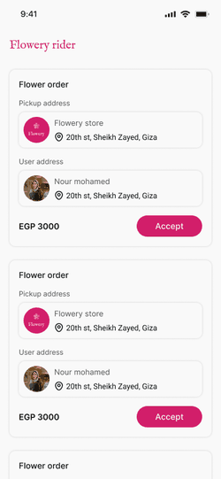

<div align="center">

# Tracking App

### Delivery Order Tracking

A Flutter mobile app for tracking delivery orders in real time &mdash;<br>driver location tracking, order status updates, and an authenticated driver experience.

    

<table>
  <tr>
    <td align="center"><br><sub><b>Incoming request → accept → pickup → route to customer → delivered</b></sub><br><sub><i>Walkthrough of screens from the project's Figma design file</i></sub></td>
  </tr>
</table>

</div>

---

## Table of Contents

- [Overview](#overview)
- [My Role](#my-role)
- [Features](#features)
- [Tech Stack](#tech-stack)
- [Architecture](#architecture)
- [Application Screenshots](#application-screenshots)
- [Getting Started](#getting-started)
- [Testing](#testing)
- [Provenance](#provenance)

---

## Overview

Tracking App focuses on the last-mile delivery experience: customers and drivers authenticate,
drivers' live location is tracked and shared, and order details and status are surfaced to the
relevant parties in real time.

Originally built as a team project; this repository is an independent, actively maintained
continuation.

---

## My Role

I worked as a Flutter/mobile developer on the team that built this app, contributing to the mobile
client within the Clean Architecture structure shared across the codebase. This repository is
maintained independently going forward under my own account, with permission from the original team.

---

## Features

| Area | Capabilities |
| :--- | :--- |
| **Authentication** | Login, forgot/reset password |
| **Live location tracking** | Driver location tracking and distance calculation |
| **Orders** | Order details and status tracking |
| **Onboarding** | Introductory onboarding flow |
| **Media** | Image picking (for example proof of delivery or profile) |
| **Localization** | Arabic / English |
| **Session security** | Secure token storage with automatic refresh |

---

## Tech Stack

| Concern | Libraries |
| :--- | :--- |
| State management | `flutter_bloc` |
| Dependency injection | `get_it`, `injectable` |
| Networking | `dio`, `retrofit` (interceptor-based logging and token refresh) |
| Secure storage | `flutter_secure_storage` |
| Code generation | `freezed`, `json_serializable`, `build_runner` |
| Routing | `go_router` |
| Maps & location | `flutter_map`, `geolocator`, `latlong2` |
| Media | `image_picker`, `cached_network_image`, `flutter_svg`, `lottie` |
| Localization | `easy_localization` |
| UI | `flutter_screenutil`, `shimmer`, `pinput` |
| Testing | `flutter_test`, `mockito`, `bloc_test` |

---

## Architecture

The app follows **Clean Architecture** with a **feature-first** folder structure:

### Project Structure

```text
Tracking_app/
├── android/ · ios/ · web/    # Platform projects
├── linux/ · macos/ · windows/
├── assets/
│   ├── animations/           # Lottie delivery animation
│   ├── demo/                 # Animated flow preview used in this README
│   ├── images/               # App images
│   ├── screenshots/          # UI screens from the Figma design file
│   └── translations/         # Arabic / English localization
├── lib/
│   ├── app/                  # Routing and app bootstrap
│   ├── core/                 # DI, networking, errors, theme,
│   │                         # services, shared widgets
│   └── features/             # auth · location_tracking · on_bording
├── test/                     # Unit and widget tests (27 files)
└── pubspec.yaml
```

Each feature is split into `api` / `data` / `domain` / `presentation` layers, with BLoC/Cubit
managing presentation state, repositories abstracting data sources, and dependency injection wiring
it all together via `get_it` + `injectable`.

---

## Application Screenshots

A selection of the main screens, taken from the project's Figma design file.

### Getting Started

Onboarding and picking up an incoming delivery request.

<table>
  <tr>
    <td align="center" valign="top" width="33%"><br><sub><b>Onboarding</b></sub></td>
    <td align="center" valign="top" width="33%"><br><sub><b>Incoming requests</b></sub></td>
    <td align="center" valign="top" width="33%"><br><sub><b>Order accepted</b></sub></td>
  </tr>
</table>

### Collecting the Order

Navigating to the store and confirming pickup.

<table>
  <tr>
    <td align="center" valign="top" width="33%"><br><sub><b>Route to pickup</b></sub></td>
    <td align="center" valign="top" width="33%"><br><sub><b>Order picked up</b></sub></td>
    <td align="center" valign="top" width="33%"><br><sub><b>Out for delivery</b></sub></td>
  </tr>
</table>

### Completing the Delivery

Navigating to the customer and closing out the job.

<table>
  <tr>
    <td align="center" valign="top" width="33%"><br><sub><b>Route to customer</b></sub></td>
    <td align="center" valign="top" width="33%"><br><sub><b>Delivered</b></sub></td>
    <td align="center" valign="top" width="33%"><br><sub><b>Delivery completed</b></sub></td>
  </tr>
</table>

### History & Account

Past deliveries and rider account management.

<table>
  <tr>
    <td align="center" valign="top" width="33%"><br><sub><b>My orders</b></sub></td>
    <td align="center" valign="top" width="33%"><br><sub><b>Completed order</b></sub></td>
    <td align="center" valign="top" width="33%"><br><sub><b>Profile</b></sub></td>
  </tr>
</table>

> The complete screen-by-screen set, including authentication, error states and an earlier design iteration of the delivery flow, is available in [`assets/screenshots/`](assets/screenshots/).

---

## Getting Started

### Prerequisites

- **Flutter SDK** — see `.metadata` for the pinned version
- **`.env` file** at the project root — see the `assets` section of `pubspec.yaml` for runtime
  configuration

### Setup

```bash
# 1. Install Flutter dependencies
flutter pub get

# 2. Generate code (DI, freezed, json_serializable, retrofit)
dart run build_runner build --delete-conflicting-outputs

# 3. Run the app
flutter run
```

---

## Testing

```bash
flutter test
```

---

## Provenance

This app was originally developed collaboratively by a team (originally hosted at
`joudysami/Tracking_app`). It is now maintained independently here with the original contributors'
permission, as a standalone continuation of that work.
