# Tracking App — Delivery Order Tracking

A Flutter mobile app for tracking delivery orders in real time, including driver location tracking, order status updates, and an authenticated customer/driver experience. Originally built as a team project; this repository is an independent, actively maintained continuation.

## Overview

Tracking App focuses on the last-mile delivery experience: customers and drivers authenticate, drivers' live location is tracked and shared, and order details/status are surfaced to the relevant parties in real time.

## My Role

I worked as a Flutter/mobile developer on the team that built this app, contributing to the mobile client within the Clean Architecture structure shared across the codebase. This repository is maintained independently going forward under my own account, with permission from the original team.

## Features

- Authentication (login, forgot/reset password)
- Live location tracking (driver location, distance calculation)
- Order details and status tracking
- Onboarding flow
- Image picking (e.g. for proof of delivery / profile)
- Localization (Arabic/English)
- Secure token storage with automatic refresh

## Tech Stack

- State management: `flutter_bloc`
- Dependency injection: `get_it` + `injectable`
- Networking: `dio` + `retrofit`, with interceptor-based logging and token refresh
- Secure storage: `flutter_secure_storage`
- Code generation: `freezed`, `json_serializable`, `build_runner`
- Routing: `go_router`
- Maps & location: `flutter_map`, `geolocator`, `latlong2`
- Media: `image_picker`, `cached_network_image`, `flutter_svg`, `lottie`
- Localization: `easy_localization`
- UI: `flutter_screenutil`, `shimmer`, `pinput`
- Testing: `flutter_test`, `mockito`, `bloc_test`

## Architecture

The app follows **Clean Architecture** with a **feature-first** folder structure:

```
lib/
├── app/             # Routing, app bootstrap
├── core/            # Shared infrastructure: DI, networking, errors, theme, widgets, services
└── features/
    ├── auth/
    ├── location_tracking/
    └── on_bording/
```

Each feature is split into `api` / `data` / `domain` / `presentation` layers, with BLoC/Cubit managing presentation state, repositories abstracting data sources, and dependency injection wiring it all together via `get_it` + `injectable`.

## Application Screenshots

Screens below are taken from the project's Figma design file and exported as PNG. They are grouped by the rider's journey through the app.

### Authentication

<table>
  <tr>
    <td align="center" valign="top" width="33%">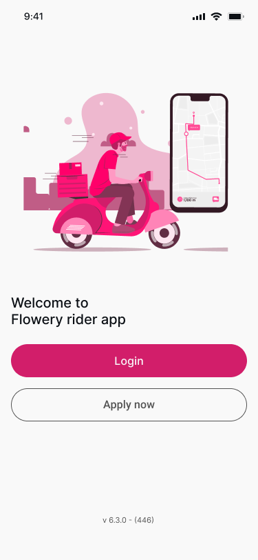<br><sub><b>Onboarding</b></sub></td>
    <td align="center" valign="top" width="33%">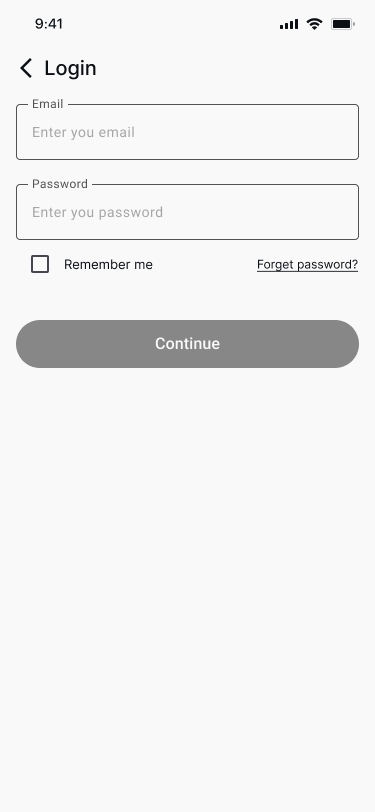<br><sub><b>Login</b></sub></td>
    <td align="center" valign="top" width="33%">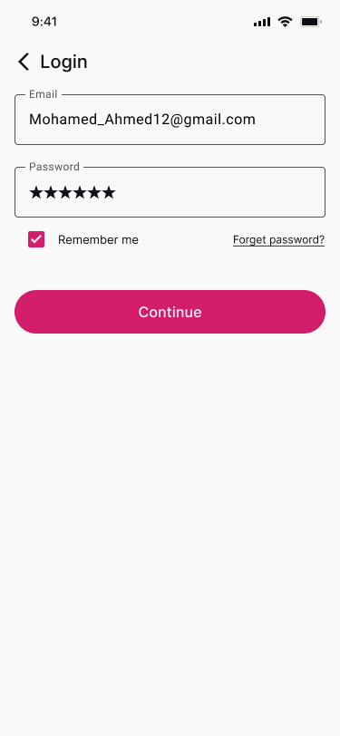<br><sub><b>Login — filled</b></sub></td>
  </tr>
  <tr>
    <td align="center" valign="top" width="33%">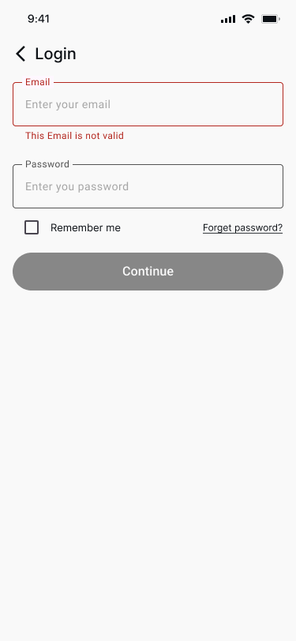<br><sub><b>Login — email error</b></sub></td>
    <td align="center" valign="top" width="33%">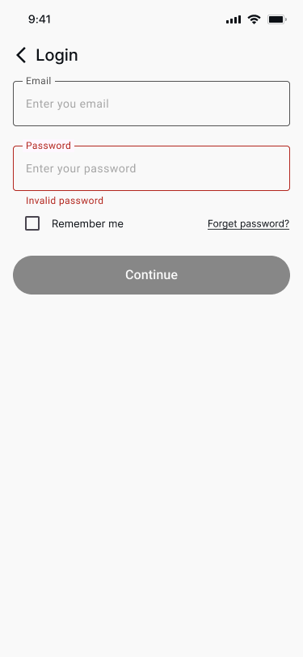<br><sub><b>Login — password error</b></sub></td>
    <td align="center" valign="top" width="33%">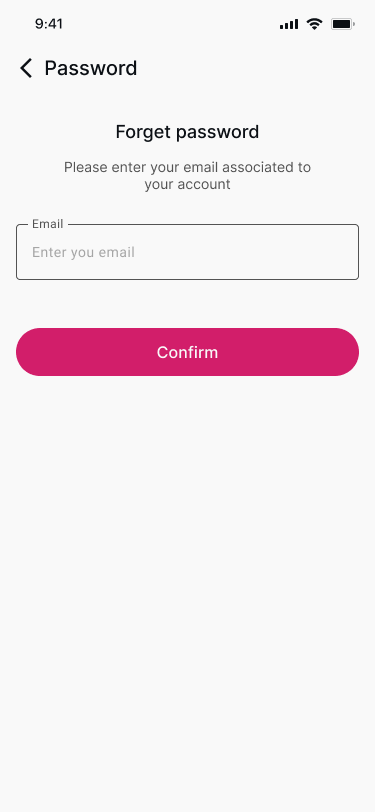<br><sub><b>Forgot password</b></sub></td>
  </tr>
  <tr>
    <td align="center" valign="top" width="33%">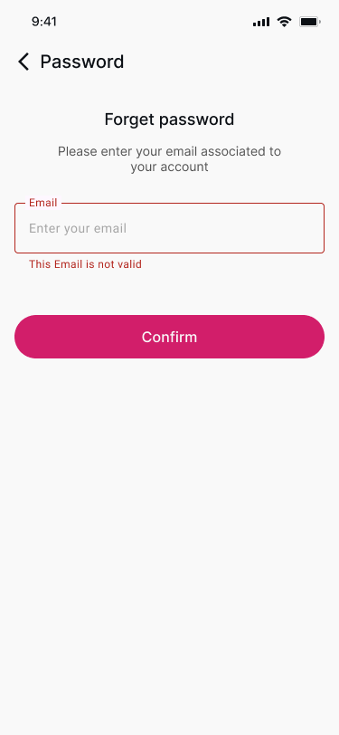<br><sub><b>Forgot password — invalid email</b></sub></td>
    <td align="center" valign="top" width="33%">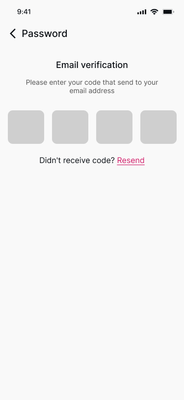<br><sub><b>Email verification</b></sub></td>
    <td align="center" valign="top" width="33%">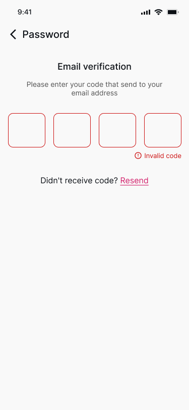<br><sub><b>Email verification — invalid code</b></sub></td>
  </tr>
  <tr>
    <td align="center" valign="top" width="33%">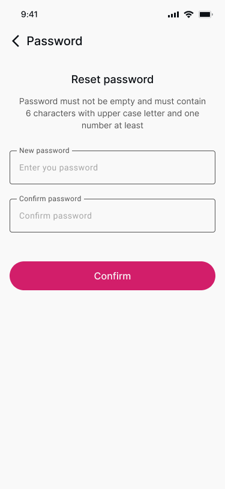<br><sub><b>Set new password</b></sub></td>
    <td width="33%"></td>
    <td width="33%"></td>
  </tr>
</table>

### Rider Application

<table>
  <tr>
    <td align="center" valign="top" width="33%">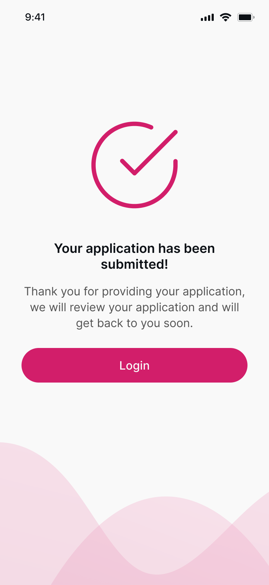<br><sub><b>Application submitted</b></sub></td>
    <td width="33%"></td>
    <td width="33%"></td>
  </tr>
</table>

### Delivery Flow

The rider's active delivery journey, in order: accept a request, navigate to the store, collect the order, navigate to the customer, and complete the delivery.

<table>
  <tr>
    <td align="center" valign="top" width="33%">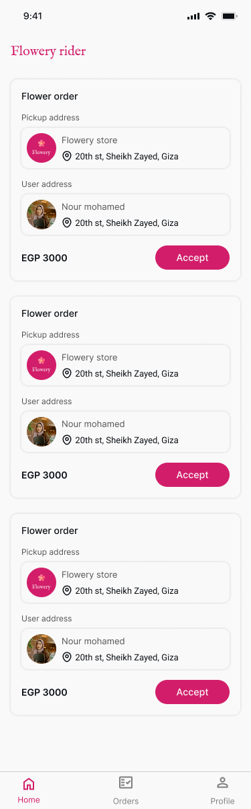<br><sub><b>Home — incoming requests</b></sub></td>
    <td align="center" valign="top" width="33%">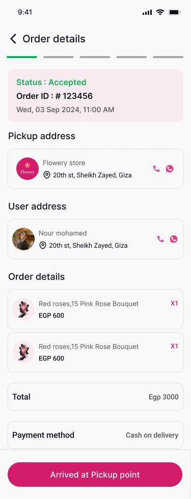<br><sub><b>Order details — accepted</b></sub></td>
    <td align="center" valign="top" width="33%">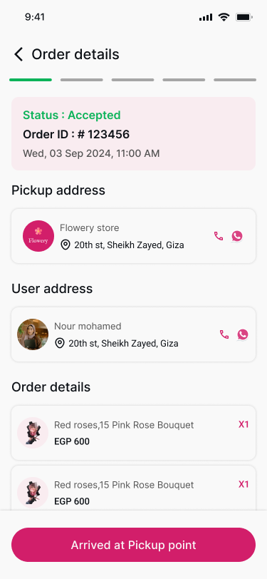<br><sub><b>Order details — accepted (viewport crop)</b></sub></td>
  </tr>
  <tr>
    <td align="center" valign="top" width="33%">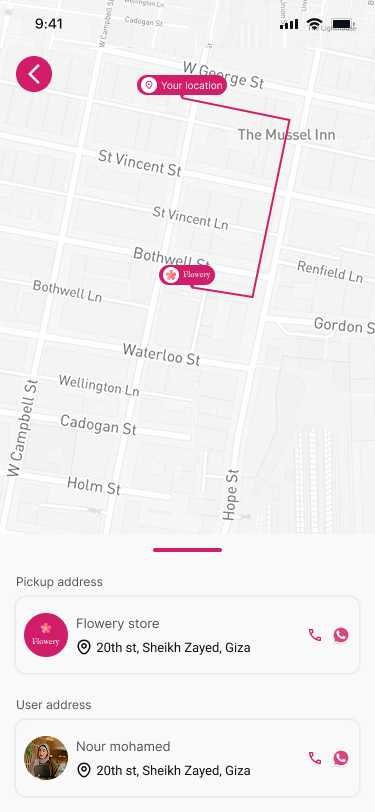<br><sub><b>Navigation — route to pickup</b></sub></td>
    <td align="center" valign="top" width="33%">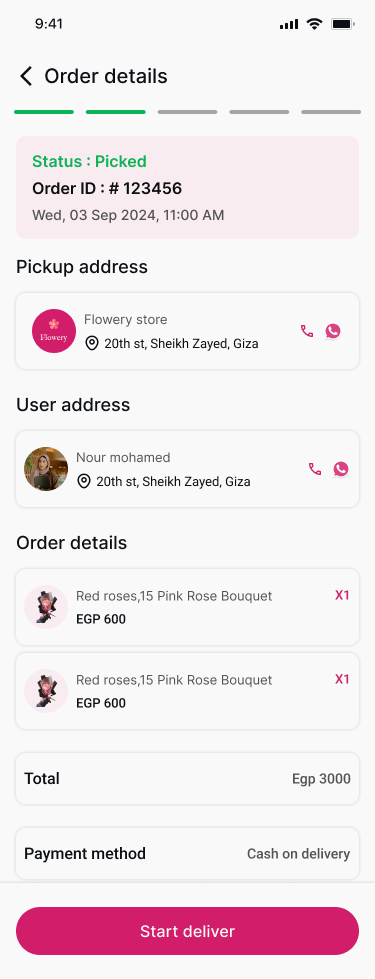<br><sub><b>Order details — picked up</b></sub></td>
    <td align="center" valign="top" width="33%">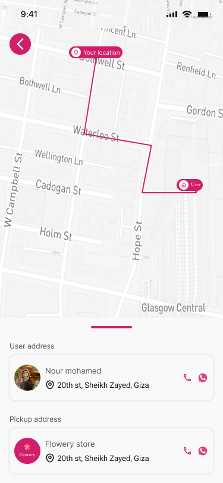<br><sub><b>Navigation — route to customer</b></sub></td>
  </tr>
  <tr>
    <td align="center" valign="top" width="33%">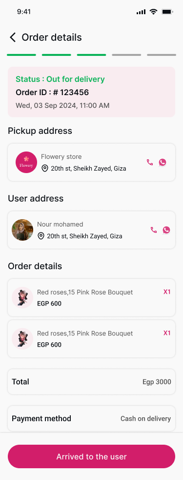<br><sub><b>Order details — out for delivery</b></sub></td>
    <td align="center" valign="top" width="33%">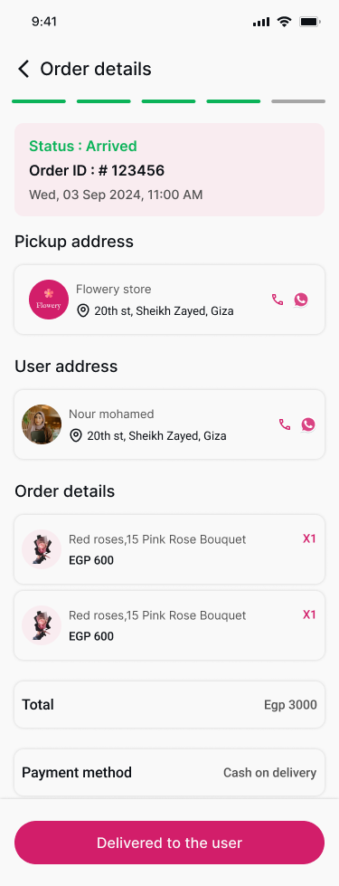<br><sub><b>Order details — arrived</b></sub></td>
    <td align="center" valign="top" width="33%">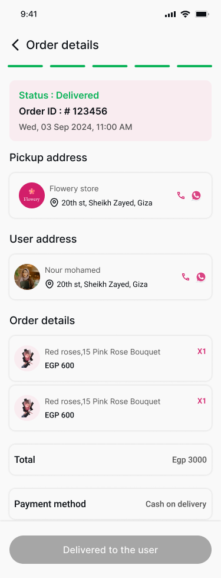<br><sub><b>Order details — delivered</b></sub></td>
  </tr>
  <tr>
    <td align="center" valign="top" width="33%">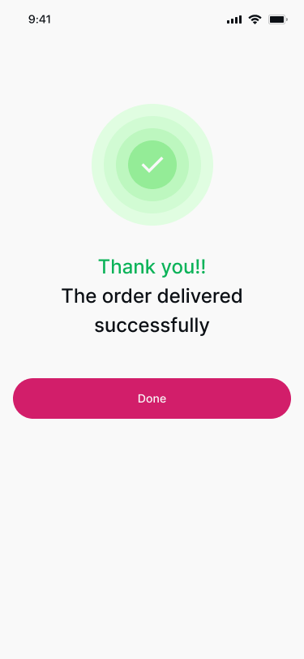<br><sub><b>Delivery completed</b></sub></td>
    <td width="33%"></td>
    <td width="33%"></td>
  </tr>
</table>

### Order History

<table>
  <tr>
    <td align="center" valign="top" width="33%">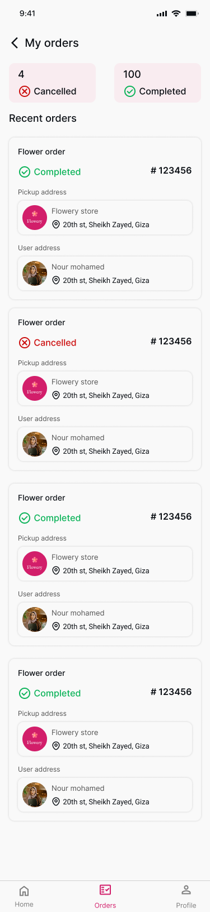<br><sub><b>My orders</b></sub></td>
    <td align="center" valign="top" width="33%">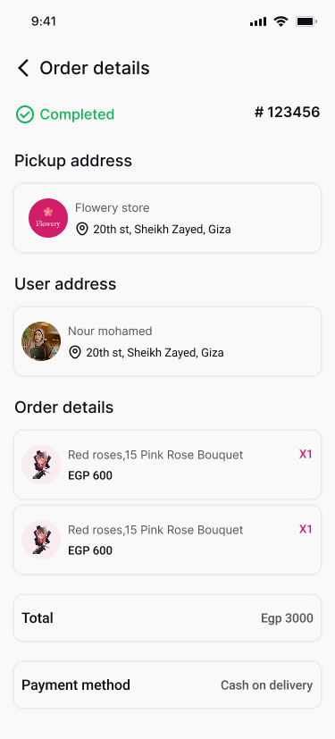<br><sub><b>Order details — completed (read-only)</b></sub></td>
    <td width="33%"></td>
  </tr>
</table>

### Account & Profile

<table>
  <tr>
    <td align="center" valign="top" width="33%">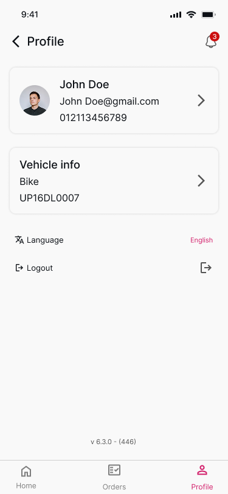<br><sub><b>Profile</b></sub></td>
    <td align="center" valign="top" width="33%">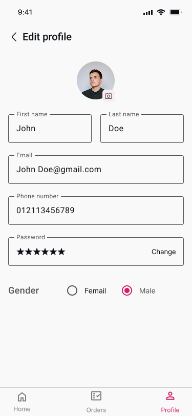<br><sub><b>Edit profile — personal details</b></sub></td>
    <td align="center" valign="top" width="33%">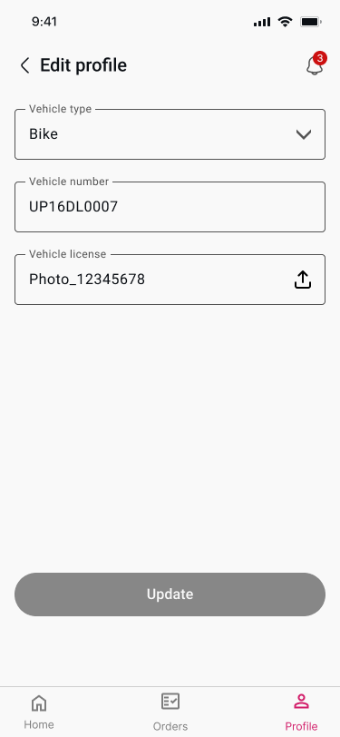<br><sub><b>Edit profile — vehicle details</b></sub></td>
  </tr>
  <tr>
    <td align="center" valign="top" width="33%">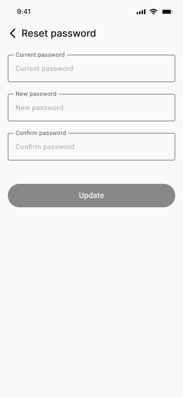<br><sub><b>Change password</b></sub></td>
    <td align="center" valign="top" width="33%">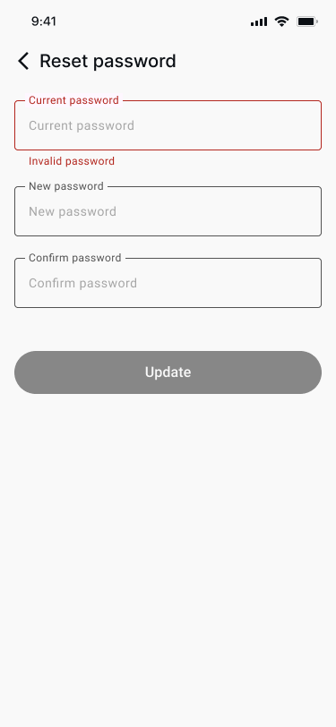<br><sub><b>Change password — error</b></sub></td>
    <td align="center" valign="top" width="33%">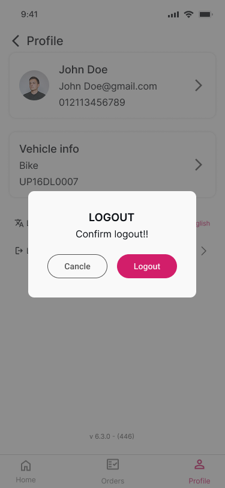<br><sub><b>Profile — logout confirmation</b></sub></td>
  </tr>
</table>

### Alternate Design Iteration

An earlier iteration of the same delivery flow kept in the design file. It embeds a collapsible map directly into the order-details screen, instead of the dedicated navigation screens used by the current flow above. The completion screen is shared with the current flow.

<table>
  <tr>
    <td align="center" valign="top" width="33%">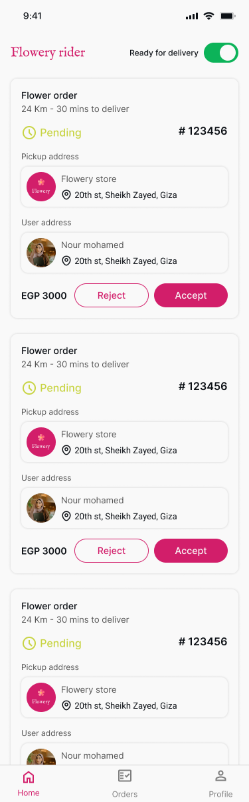<br><sub><b>Home — with availability toggle</b></sub></td>
    <td align="center" valign="top" width="33%">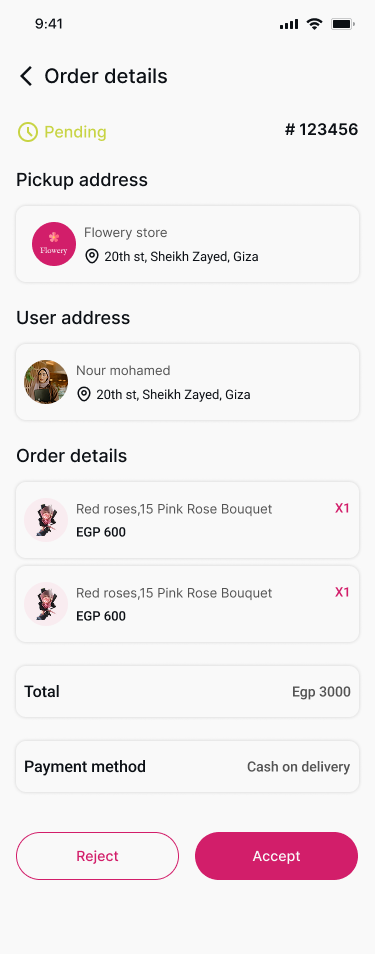<br><sub><b>Order request — accept or reject</b></sub></td>
    <td align="center" valign="top" width="33%">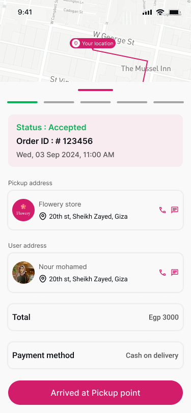<br><sub><b>Tracking — accepted</b></sub></td>
  </tr>
  <tr>
    <td align="center" valign="top" width="33%">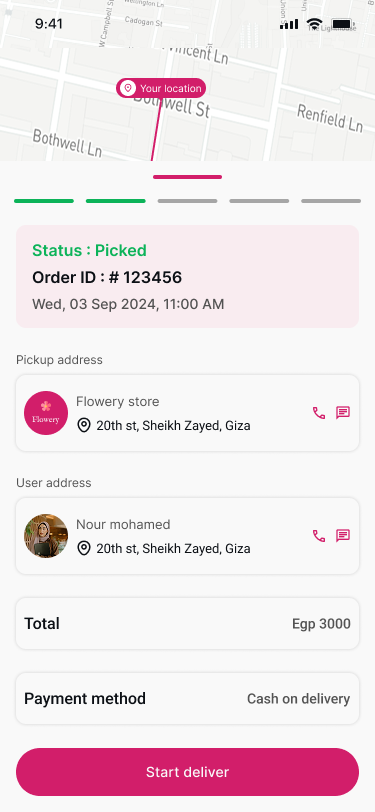<br><sub><b>Tracking — picked up</b></sub></td>
    <td align="center" valign="top" width="33%">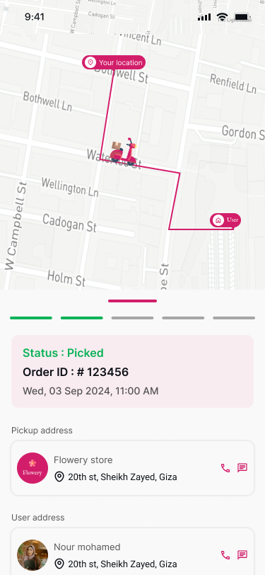<br><sub><b>Tracking — picked up (map expanded)</b></sub></td>
    <td align="center" valign="top" width="33%">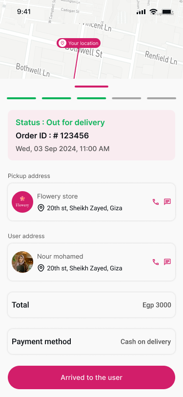<br><sub><b>Tracking — out for delivery</b></sub></td>
  </tr>
  <tr>
    <td align="center" valign="top" width="33%">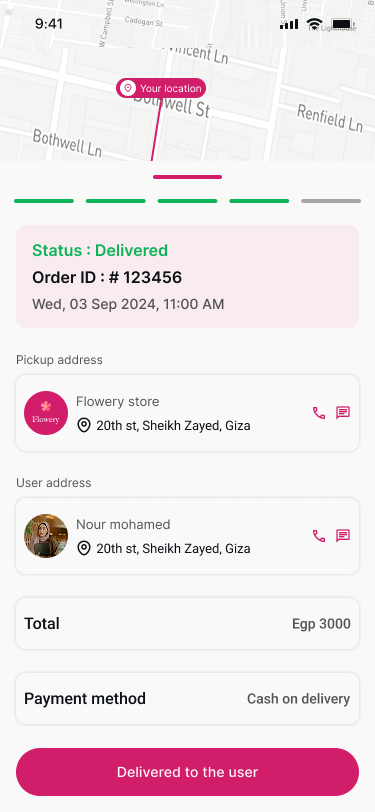<br><sub><b>Tracking — final step</b></sub></td>
    <td align="center" valign="top" width="33%">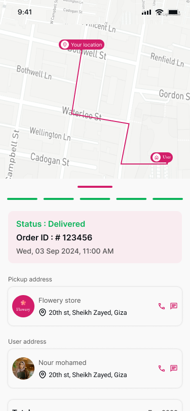<br><sub><b>Tracking — delivered (map expanded)</b></sub></td>
    <td width="33%"></td>
  </tr>
</table>

## Getting Started

### Prerequisites
- Flutter SDK (see `.metadata` for the pinned version)
- A `.env` file at the project root (see `pubspec.yaml` assets) for runtime configuration

### Setup

```bash
# Install Flutter dependencies
flutter pub get

# Generate code (DI, freezed, json_serializable, retrofit)
dart run build_runner build --delete-conflicting-outputs

# Run the app
flutter run
```

## Testing

```bash
flutter test
```

## Provenance

This app was originally developed collaboratively by a team (originally hosted at `joudysami/Tracking_app`). It is now maintained independently here with the original contributors' permission, as a standalone continuation of that work.
